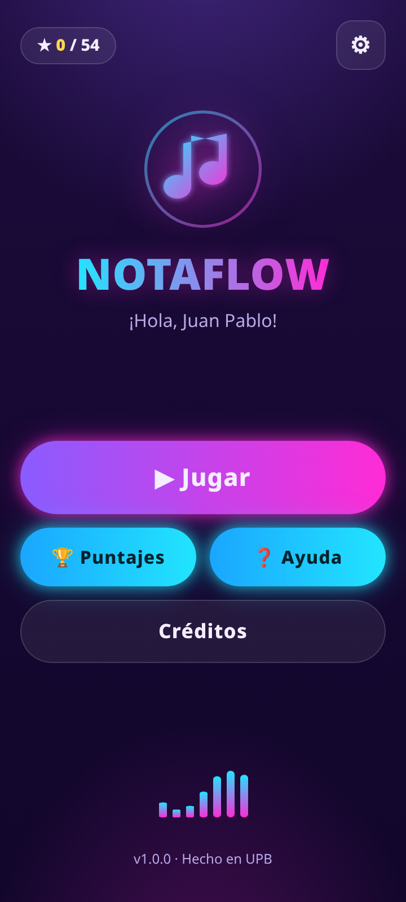
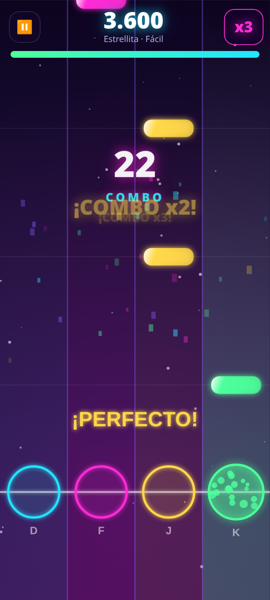
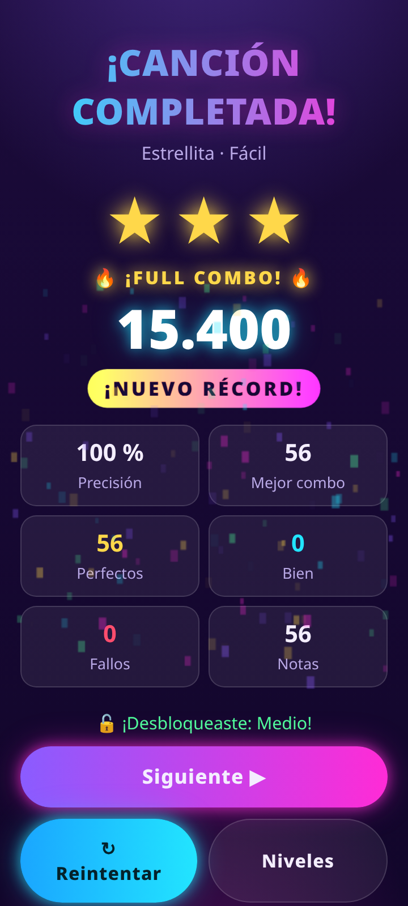

# NotaFlow 🎸

Juego rítmico para celular (estilo *Guitar Hero* / *Piano Tiles*) hecho con **Capacitor 8 + Vite + JavaScript puro**.
Proyecto de la **Entrega #4 – Juego** del curso *Aplicaciones móviles* (UPB).

Las notas caen por 4 carriles y hay que tocarlas justo cuando llegan a la línea brillante. Toda la música y los
efectos de sonido se **sintetizan por código** con la Web Audio API (no hay archivos de audio con derechos de autor).

| Inicio | Juego | Resultados |
|:--:|:--:|:--:|
|  |  |  |

## Características

- **7 canciones** (6 normales + 1 secreta), cada una con **3 niveles** (Fácil, Medio, Difícil). Ver tabla abajo.
- **Pantallas**: Splash, Inicio, Ajustes, Cómo jugar, Selección de canción, Selección de nivel, Juego (con Pausa),
  Resultados, Puntajes y Créditos.
- **Interfaz personalizada** con tema neón (morado oscuro, cian y magenta), logo propio y animaciones.
- **Animaciones**: transiciones entre pantallas, partículas y brillos al acertar, pulso con el ritmo, estrellas que
  aparecen una a una, confeti, viñeta roja al fallar.
- **Sonidos**: música y efectos sintetizados (guitarra, piano, sintetizador, bombo, caja, hi-hat, bajo).
- **Persistencia de datos** con `localStorage`: nombre del jugador, ajustes, estrellas y mejor puntaje por nivel,
  ranking de partidas, progreso de desbloqueo y secretos encontrados (sobreviven a cerrar la app).
- **Vibración** al fallar o acertar (se puede desactivar en Ajustes) y botón *atrás* de Android integrado.
- **Easter eggs** (bonus): ver la sección correspondiente.

## Cómo jugar

1. Toca **Jugar**, elige una canción y un nivel.
2. Cuando una nota llegue al círculo de su carril, **toca ese carril** (en computador: teclas **D F J K**).
3. Según la precisión obtienes **¡Perfecto!** (100 pts), **Bien** (60 pts) o **Fallo** (te quita vida).
4. Los aciertos seguidos suben el **combo**: multiplicador x2 (10 aciertos), x3 (20) y x4 (40).
5. Si la barra de vida llega a cero pierdes. Al terminar ganas **1 a 3 estrellas** según tu precisión
   (≥50 %, ≥75 %, ≥90 %).
6. Con **al menos 1 estrella** se desbloquea el siguiente nivel y, en el nivel Fácil, la siguiente canción.
7. Puedes pausar con el botón ⏸ (o `Esc` / `P` en computador).

### Canciones y niveles

| # | Canción | Origen | BPM | Instrumento |
|---|---------|--------|-----|-------------|
| 1 | Estrellita | Tradicional (dominio público) | 100 | Piano |
| 2 | Himno a la Alegría | L. v. Beethoven (dominio público) | 108 | Piano |
| 3 | Para Elisa | L. v. Beethoven (dominio público) | 62 | Piano |
| 4 | Cascabeles | J. Pierpont (dominio público) | 124 | Guitarra |
| 5 | Neon Pulse | Original del equipo | 128 | Sintetizador |
| 6 | Latido Cósmico | Original del equipo | 112 | Guitarra |
| ★ | Arcoíris | Original del equipo (**secreta**) | 144 | Sintetizador |

Cada canción tiene los niveles **Fácil**, **Medio** y **Difícil**, que cambian la velocidad de caída, la cantidad de
notas, los acordes y el margen de acierto (ver `src/niveles.js`).

### Easter eggs 🥚

1. **7 toques seguidos al logo** de la pantalla de inicio → desbloquea la canción secreta *Arcoíris*, el modo arcoíris y confeti.
2. **5 toques a "HECHO EN UPB"** en Créditos → lluvia de confeti.
3. **FULL COMBO**: terminar una canción sin ningún fallo muestra la insignia 🔥.

## Estructura del proyecto

```
NotaFlow/
├── index.html                 # Página única de la app
├── capacitor.config.json      # Configuración de Capacitor (id com.notaflow.juego)
├── vite.config.js
├── android/                   # Proyecto Android generado por Capacitor
├── src/
│   ├── main.js                # Arranque: registra las pantallas y el botón atrás
│   ├── enrutador.js           # Navegación entre pantallas con transiciones
│   ├── almacenamiento.js      # Persistencia (localStorage)
│   ├── audio.js               # Motor de sonido (Web Audio): instrumentos y efectos
│   ├── vibracion.js           # Vibración respetando los ajustes
│   ├── progreso.js            # Reglas de desbloqueo de niveles y canciones
│   ├── niveles.js             # Dificultad (Fácil/Medio/Difícil) y generador de notas
│   ├── canciones/             # Una melodía por archivo, escrita como texto ("C4 D4 E4:2")
│   ├── motor/                 # Lógica del juego (partida), dibujo en canvas, partículas
│   ├── pantallas/             # Una pantalla por archivo
│   ├── estilos/               # CSS (paleta neón, animaciones)
│   └── util/                  # Utilidades (logo, confeti, música, DOM)
├── pruebas/e2e.py             # Pruebas automáticas del juego con Playwright
├── herramientas/              # Scripts: iconos, capturas y gráfico de la tienda
├── docs/
│   ├── capturas/              # Capturas de pantalla (360x800)
│   ├── diseno/                # Wireframes (papel y Figma)
│   ├── tienda/                # Textos e imágenes para Google Play
│   └── politica-privacidad.*  # Política de privacidad (se publica con GitHub Pages)
├── TAREAS_EQUIPO.md           # Reparto de tareas del equipo
└── README.md
```

### Cómo funciona por dentro (resumen)

- Las **melodías** se escriben como texto (`src/canciones/notacion.js`). Para cada nivel, `src/niveles.js` convierte la
  melodía en notas que caen por los carriles usando un generador con semilla (siempre sale el mismo mapa).
- `src/motor/partida.js` es la **lógica pura** del juego (puntaje, combo, vida, estrellas); no toca el DOM, por eso se
  puede probar de forma automática.
- `src/motor/dibujo.js` pinta los carriles y las notas en un `<canvas>`; `src/audio.js` sintetiza todo el sonido.

## Cómo compilar y ejecutar

Requisitos: **Node.js 22+**, y para Android **JDK 21** y el **Android SDK** (Android Studio).

```bash
git clone https://github.com/JuanVal0308/NotaFlow.git
cd NotaFlow
npm install
npm run dev            # abre el juego en el navegador (http://localhost:5173)
```

Para probarlo en el computador usa las teclas **D F J K** o el mouse. En Chrome conviene abrir las herramientas de
desarrollador y activar la vista de celular (Ctrl+Shift+M).

### Generar la app Android

```bash
npm run build          # genera la carpeta dist/
npx cap sync android   # copia dist/ al proyecto Android (o: npm run sync)
cd android
./gradlew assembleDebug        # APK de prueba: app/build/outputs/apk/debug/app-debug.apk
./gradlew bundleRelease        # AAB para Google Play (necesita tu llave de firma)
```

> La llave de firma (`.jks`) y sus contraseñas **nunca** se suben al repositorio (están en `.gitignore`).
> Para firmar el AAB se pasan por línea de comandos: `-Pandroid.injected.signing.store.file=... .store.password=... .key.alias=... .key.password=...`

### Pruebas automáticas

```bash
npm run dev &                 # el servidor debe estar activo
pip install playwright         # una sola vez (y tener Chrome instalado)
python3 pruebas/e2e.py        # recorre todas las pantallas, juega una canción perfecta, una fallida y revisa la persistencia
```

Las pruebas usan un reloj manual (`?test=1`) para que el resultado sea siempre el mismo y regeneran las capturas en
`docs/capturas/`. Último resultado: **48/48 comprobaciones correctas**.

## Equipo

| Integrante | Responsabilidad principal |
|------------|---------------------------|
| Juan Pablo Martinez Romero | Motor del juego, audio, interfaz y empaquetado Android |
| Integrante 2 | Canciones nuevas, ajuste de niveles, textos de ayuda y easter eggs |
| Integrante 3 | Efectos de sonido, documentación, tema de color, textos de la tienda y pruebas en celular |

El detalle paso a paso de lo que hace cada uno está en [`TAREAS_EQUIPO.md`](TAREAS_EQUIPO.md).
Los wireframes en papel y Figma están en [`docs/diseno/`](docs/diseno/).

## Diseño y tienda

- **Diseño (wireframes):** bocetos en papel (lápiz digital) y wireframes editables de Figma en escala de grises.
  - Figma: [NotaFlow – Wireframes](https://www.figma.com/design/0YzDwMdLt5DerDbry2Su1Z/NotaFlow---Wireframes) (12 frames).
  - Archivos: [`docs/diseno/papel/`](docs/diseno/papel/) (bocetos), [`docs/diseno/figma-svg/`](docs/diseno/figma-svg/) y
    [`docs/diseno/figma-png/`](docs/diseno/figma-png/). Guía completa en [`docs/diseno/README.md`](docs/diseno/README.md).
- **Material de Google Play** ([`docs/tienda/`](docs/tienda/)):
  - Icono: [`icono-512.png`](docs/tienda/icono-512.png) (512×512).
  - Gráfico de funciones: [`grafico-funciones-1024x500.png`](docs/tienda/grafico-funciones-1024x500.png).
  - 8 capturas de 1080×1920: [`capturas-1080x1920/`](docs/tienda/capturas-1080x1920/).
  - Textos de la ficha (descripción, clasificación, seguridad de datos): [`textos.md`](docs/tienda/textos.md).
- **Política de privacidad:** https://juanval0308.github.io/NotaFlow/politica-privacidad.html
  (fuente: [`docs/politica-privacidad.md`](docs/politica-privacidad.md)). NotaFlow no recopila datos personales.

## Justificación del uso de IA y código comentado

- **Uso de IA**: se usó un asistente de inteligencia artificial como apoyo para generar la base del proyecto
  (estructura, motor del juego, sintetizador de sonido, pantallas y pruebas automáticas). Esto está permitido en
  la entrega siempre que se justifique: la IA aceleró el trabajo repetitivo y permitió dedicar el tiempo del equipo a
  diseñar la experiencia (wireframes, canciones, niveles, textos), revisar el código, probar la app en celulares y
  publicarla. Todo el código fue revisado y es entendido por el equipo; el resto de integrantes continúa el
  desarrollo con las tareas de `TAREAS_EQUIPO.md`.
- **Código comentado**: todos los archivos empiezan con un comentario en español que explica su propósito, y las
  funciones importantes tienen comentarios que describen qué hacen y por qué. Los nombres de variables, funciones y
  textos de la interfaz también están en español para que sean fáciles de seguir.
- **Música**: las melodías son de **dominio público** (Estrellita, Himno a la Alegría, Para Elisa, Cascabeles) o
  **composiciones originales** del equipo, y se sintetizan por código; no se usan grabaciones.

## Licencia

Proyecto académico – Universidad Pontificia Bolivariana (UPB). Hecho en UPB ★
