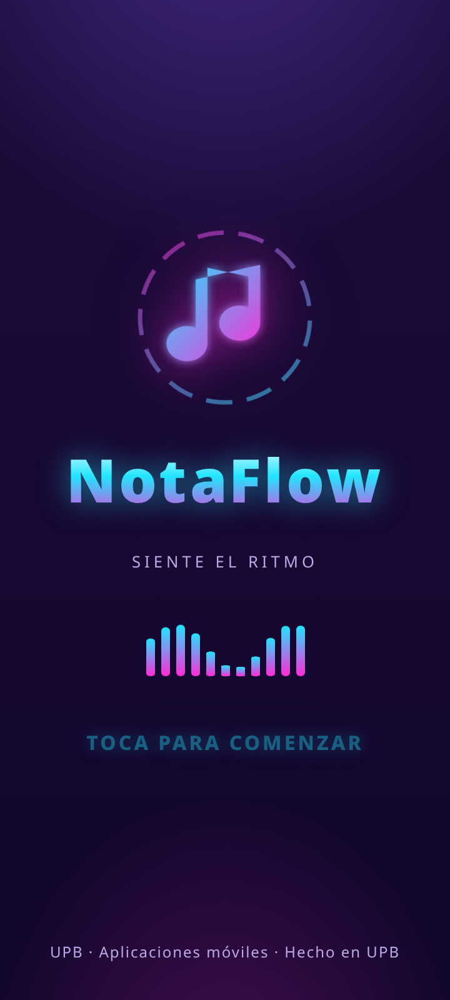
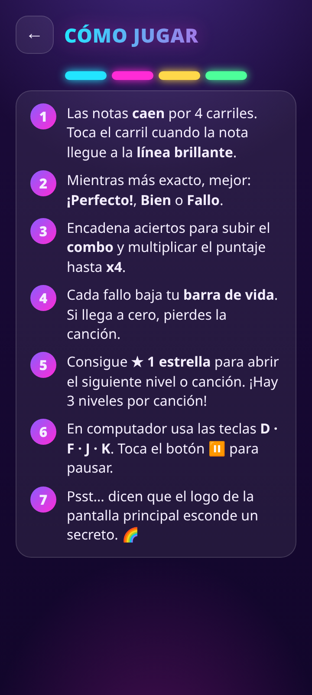
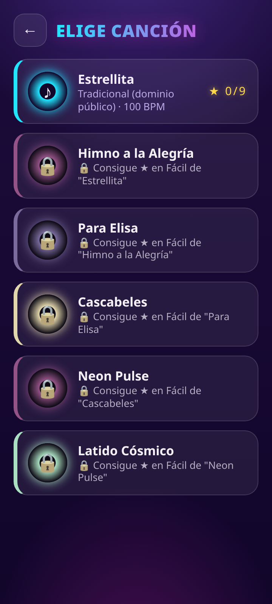
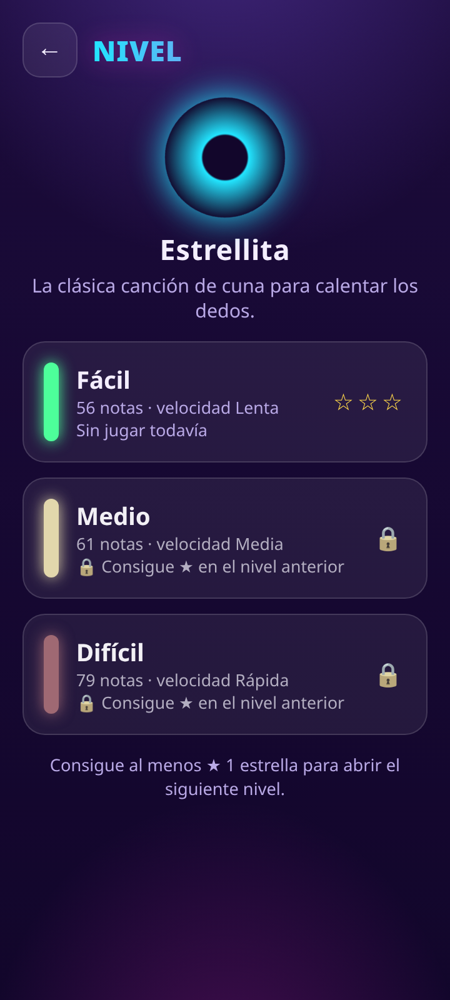
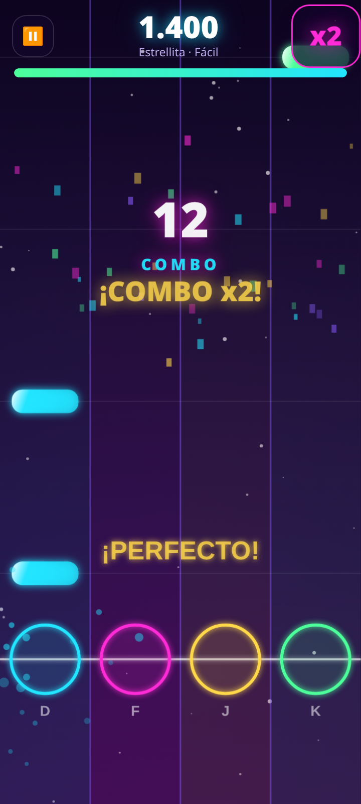
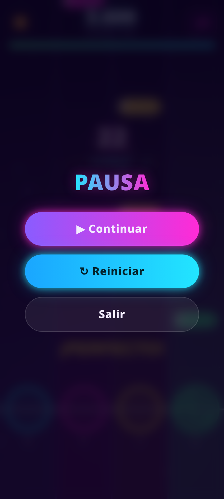
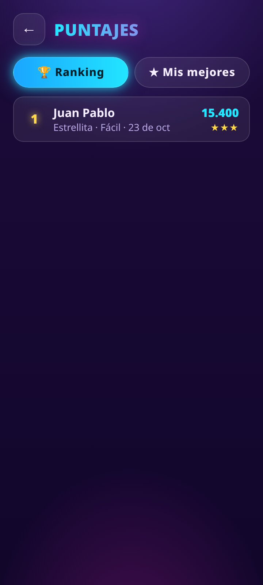
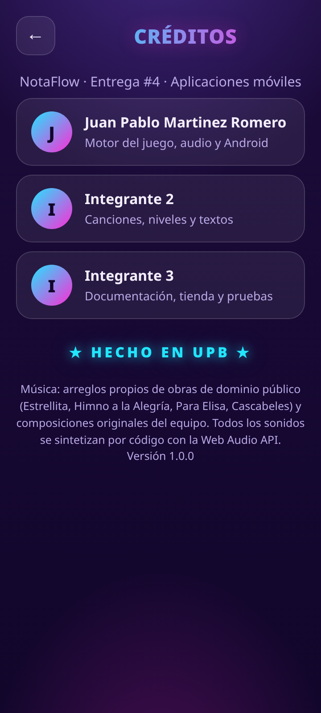
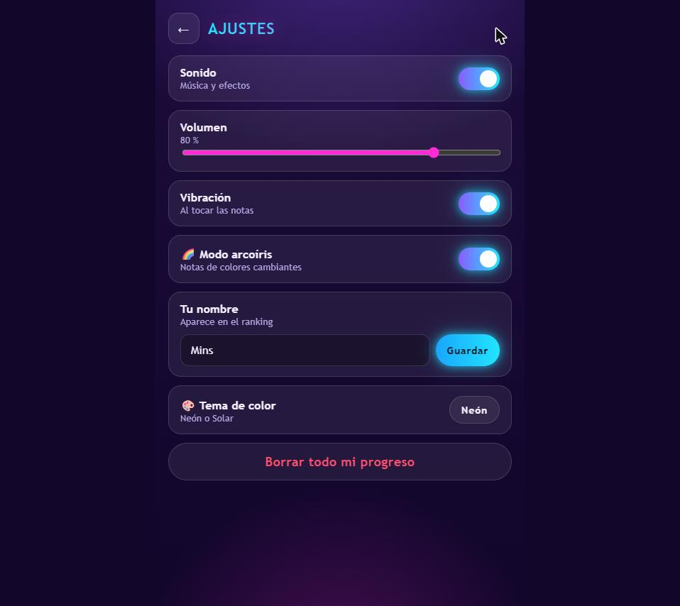

# Manual de usuario — NotaFlow

Guía rápida de cada pantalla del juego, con una captura real tomada de la app (carpeta
[`capturas/`](capturas/)).

## Splash

Es la pantalla de bienvenida: muestra el logo y el nombre de la app con una animación corta.
Desaparece sola después de un momento y lleva directo a **Inicio**.

## Inicio

El menú principal. Desde aquí puedes:

- **▶ Jugar**: ir a la selección de canción.
- **🏆 Puntajes**: ver el ranking y tus mejores marcas.
- **❓ Ayuda**: repasar cómo jugar.
- **Créditos**: ver al equipo.
- El ícono **⚙** (arriba a la derecha) abre **Ajustes**.
- Arriba a la izquierda se ve cuántas ★ estrellas llevas en total.

Si es tu primera vez, te pide tu nombre para que aparezca en el ranking
(ver [`02-home-nombre.png`](capturas/02-home-nombre.png)).

## Cómo jugar

Explica en 8 pasos las reglas: los 4 carriles, cuándo tocar, la diferencia entre "Perfecto" y
"Bien", el combo, la vida, las estrellas y los controles de teclado (**D F J K**).

## Selección de canción

Lista las 6 canciones normales (la secreta no aparece hasta desbloquearla). Cada tarjeta muestra
artista, BPM y las estrellas conseguidas. Las canciones bloqueadas se ven con 🔒 y un mensaje de
qué falta para abrirlas; tocarlas suena un aviso de "bloqueado" en vez de abrir el nivel.
Progreso con candados: [`18-canciones-progreso.png`](capturas/18-canciones-progreso.png).

## Selección de nivel

Elige **Fácil**, **Medio** o **Difícil** para la canción escogida. Cada fila muestra cuántas notas
tiene, la velocidad, tu mejor puntaje/combo (si ya jugaste) y las estrellas ganadas. Un nivel
bloqueado pide al menos ★ en el anterior. Niveles ya desbloqueados:
[`13-niveles-desbloqueados.png`](capturas/13-niveles-desbloqueados.png).

## Juego

La pantalla principal: las notas caen por los **4 carriles** y hay que tocarlas (o usar **D F J K**)
justo cuando llegan a la línea brillante. El HUD superior muestra el puntaje, el multiplicador de
combo (x1-x4) y el botón de pausa ⏸; abajo, la barra de vida.

- Cuenta regresiva antes de empezar: [`08-juego-cuenta-atras.png`](capturas/08-juego-cuenta-atras.png)
- Combo alto: [`10-juego-combo.png`](capturas/10-juego-combo.png)
- Un fallo (resta vida): [`14-juego-fallos.png`](capturas/14-juego-fallos.png)
- Modo arcoíris (easter egg): [`20-juego-modo-arcoiris.png`](capturas/20-juego-modo-arcoiris.png)

## Pausa

Se abre con el botón ⏸ (o `Esc`/`P` en computador) y detiene la partida al instante. Desde aquí se
puede **Continuar**, **Reiniciar** el intento o **Salir** al menú.

## Resultados

Al terminar la canción (la ganes o no) se muestra: estrellas conseguidas (1 a 3, según la
precisión), el puntaje final (sube contando con animación), precisión, mejor combo, aciertos
"Perfecto"/"Bien" y fallos. Si rompiste tu récord o desbloqueaste algo nuevo, aparece un aviso.
Si te quedaste sin vida, se ve distinto: [`15-resultados-derrota.png`](capturas/15-resultados-derrota.png).

## Puntajes

Tiene dos pestañas: **🏆 Ranking** (todas tus partidas ganadas, ordenadas por puntaje) y
**★ Mis mejores** (el mejor puntaje y estrellas por canción y nivel):
[`17-puntajes-mejores.png`](capturas/17-puntajes-mejores.png).

## Créditos

Muestra al equipo y su rol, además de un aviso legal sobre la música. Tocar 5 veces
"★ HECHO EN UPB ★" lanza confeti (easter egg):
[`22-creditos-confeti.png`](capturas/22-creditos-confeti.png).

## Ajustes

Desde aquí se controla: **Sonido** (encender/apagar), **Volumen**, **Vibración**, el
**🎨 Tema de color** (Neón o Solar — ver [`25-ajustes-tema-solar.png`](capturas/25-ajustes-tema-solar.png)),
tu **nombre** para el ranking y el botón para **borrar todo tu progreso** (pide confirmación).
Si ya desbloqueaste el secreto, también aparece el interruptor de **🌈 Modo arcoíris**.
